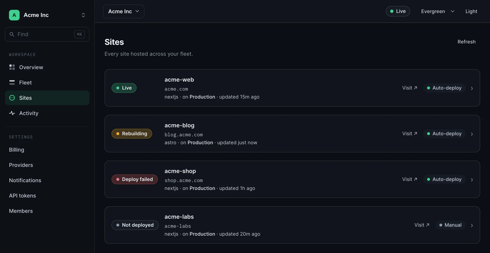

<!-- doc-tier: human | canonical-for: project-overview | budget: 1750tok -->
<picture>
  <source media="(prefers-color-scheme: dark)" srcset="docs/readme/banner-night.svg">
  
</picture>

**An open-source CMS you can run on your own computer or a server.**
Define your own fields, edit content visually, and publish it through an API.
Build a website or keep a recipe collection. Use only what you need.

[What the button does](docs/setup/DEPLOY-WITH-BARKPARK.md), and how to add it to your template.

## What you can do

| Use | What you get |
|---|---|
| Content | Your own fields, linked records, drafts, revisions, a visual editor |
| Papers | Proposals, reports and notes you share, updated live |
| Sheets | Shared tables, formulas, Excel in and out |
| Media | Images and files, tags, collections, rights |
| Work | Task boards, dependencies, agent queues, support tickets |
| Search | Full text, filters, facets, click analytics |
| AI | Chat with agents, hand them tasks, check their changes |
| Websites | Templates, deploys, your own domains |
| Servers | Start, update, archive and restore instances |
| Access | Workspaces, scoped tokens, sharing rules, single sign-on |
| Special tools | Live quizzes, ONIX book data and export |

Use each tool alone or together: in the browser, the terminal UI, the CLI or through an agent.

A Paper in the reader. It also opens in Studio to edit, and in the terminal.

The Cloud console, with sample sites and their deploy state.

## Local or remote

On your computer, the server, the database and the files stay with you, and work goes on when the internet is down.
On a server, several people share one. Each holds its own data; today you move it between them on purpose.

## News

<!-- news:start -->
**Wednesday 25 November.** 74 pull requests merged, 49 of them on two people editing one document. Two editors who type in different words of one paragraph of a rich text inside an object now both keep their words, with no banner, and a save that lands while another is being written is merged or held under the banner, never written over in silence: in Chrome that loss fell from 4 of 4 Studio runs to 0 of 10. A chat on a registered host, a person's own computer, can now be created, driven and seen only by an owner or admin seat. A javascript: link inside a rich text stored as HTML is now refused on write, and a bundle import strips such an address from a Portable Text link. [The full day](docs/news/2026-11-25.md)
- **Two editors, one document:** different words of one paragraph merge; a save landing under another is merged or held, never written over, also on a rejoin and on Save ([#28781](https://github.com/FRIKKern/barkpark/pull/28781), [#28802](https://github.com/FRIKKern/barkpark/pull/28802), [#28817](https://github.com/FRIKKern/barkpark/pull/28817), [#28792](https://github.com/FRIKKern/barkpark/pull/28792), [#28803](https://github.com/FRIKKern/barkpark/pull/28803), [#28833](https://github.com/FRIKKern/barkpark/pull/28833), [#28830](https://github.com/FRIKKern/barkpark/pull/28830))
- **Chat on a person's computer:** only an owner or admin seat creates, drives, sees or counts a registered-host chat; an answered question keeps its answers ([#28693](https://github.com/FRIKKern/barkpark/pull/28693), [#28844](https://github.com/FRIKKern/barkpark/pull/28844), [#28848](https://github.com/FRIKKern/barkpark/pull/28848), [#28852](https://github.com/FRIKKern/barkpark/pull/28852))
- **Links and stored HTML:** a script link is refused in an HTML rich text on write and stripped from an imported link; stored ids move out of the page's way; a NUL byte is a 422 ([#28695](https://github.com/FRIKKern/barkpark/pull/28695), [#28728](https://github.com/FRIKKern/barkpark/pull/28728), [#28659](https://github.com/FRIKKern/barkpark/pull/28659), [#28712](https://github.com/FRIKKern/barkpark/pull/28712))

**Tuesday 24 November.** 13 pull requests merged. In the old Studio's rich text editor, the link dialog and the link row now refuse a javascript:, data: or vbscript: address with a reason, and a rich text stored as an HTML string draws a refused link as its words, its script handlers renamed so they never run. The stored value keeps its bytes. [The full day](docs/news/2026-11-24.md)
- **Links in the old Studio:** the link dialog and link row refuse an address a link may not draw, with a reason; a legacy HTML rich text draws a refused link as words ([#28655](https://github.com/FRIKKern/barkpark/pull/28655), [#28402](https://github.com/FRIKKern/barkpark/pull/28402))
<!-- news:end -->

Earlier: [weekly editions](CHANGELOG.md)

## Get started

[Run locally](docs/setup/QUICKSTART.md) · [Open Studio](https://api.barkpark.cloud/studio) · [Deploy a server](docs/setup/SELF-HOST.md) · [Connect an agent](docs/setup/AGENT-ONRAMPS.md)

[Documentation](docs/INDEX.md) · [JavaScript docs site](js/docs/README.md) · [Build a plugin](docs/cards/plugins.md) · [Principles](docs/PHILOSOPHY.md)

[Apache-2.0 licensed](LICENSE). Optional [Barkpark Cloud](https://barkpark.cloud) hosting funds development.

<picture>
  <source media="(prefers-color-scheme: dark)" srcset="docs/readme/rib-night.svg">
  
</picture>
