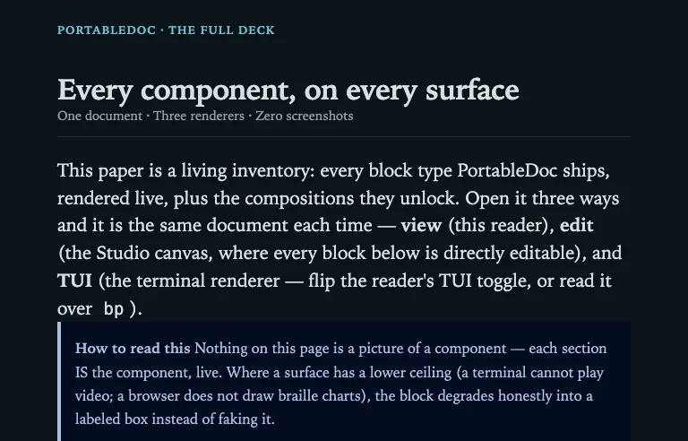
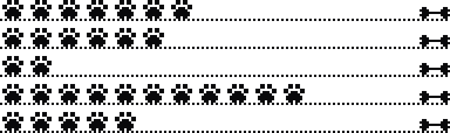

<!-- doc-tier: human | canonical-for: project-overview | budget: 1750tok -->
<picture>
  <source media="(prefers-color-scheme: dark)" srcset="docs/readme/banner-night.svg">
  
</picture>

**An open-source CMS you can run on your own computer or a server.**
Define your own fields, edit content visually, and publish it through an API.
Build a website or keep a recipe collection. Use only what you need.

[What the button does](docs/setup/DEPLOY-WITH-BARKPARK.md), and how to add it to your template.

## What you can do

| Write | Work | Run |
|---|---|---|
| Content: own fields, drafts | Tasks, agent queues, tickets | Websites, deploys, domains |
| Papers that update live | Agents you task and check | Servers: start, restore |
| Sheets: formulas, Excel | Search with facets | Tokens, sharing, sign-on |
| Media: tags, rights | Quizzes, ONIX book data | Revisions to go back to |

In the browser, the terminal, the CLI or through an agent.

## Where we're going

As of 26 November: an alpha in December, and the focus now is good and stable.

<picture>
  <source media="(prefers-color-scheme: dark)" srcset="docs/readme/progress-night.svg">
  
</picture>

| Pillar | Now |
|---|---|
| UI kit: [BarkUI](js/packages/barkui) | Building. 14 parts |
| Next-gen editor: [Fluid editor][fe] | Advanced. 3 of 7 milestones |
| [BarkBot][bb] | Building. 1 of 8 slices |
| Apps in use: [Studio][st], Papers, Sheets | Early. Studio: 51 of 66 journeys signed off |
| Invisible Barkpark: [Barkdown][bd], [Barkever][be] | Partial. Barkever: 3 of 8 milestones |

## The family

- **Barkpark**, here: the core, the API, Papers, Sheets, the CLI, BarkUI.
- **[Studio][st]**: the editing room, fast and calm.
- **[Barkdown][bd]**: a desktop app for notes, agents and browsing.
- **[Barkever][be]**: notes and projects for visual thinkers.
- **[PortableDoc][pd]**: one document format for every app.
- **[Fluid editor][fe]**: a grid editor where you place blocks freely.
- **[BarkBot][bb]**: an AI agent with its own computer.

## Local or remote

On your computer it all stays with you and works offline; on a server, several people share it.
Each holds its own data, and you move it between them on purpose.

## News

<!-- news:start -->
**Friday 27 November.** 40 pull requests merged, 33 of them on two people editing one document. A page that loses its connection now keeps what was typed while it was away, and another editor's save to a body, to a rich text inside a row, or to a picked reference or image is now kept, not written over in silence. A chat stream on a person's own computer now ends on the next re-auth tick after its owner loses the seat. The README got its knitted look. [The full day](docs/news/2026-11-27.md)
- **Two editors: rich text:** a rejoin keeps the words typed offline; a body stored as HTML, removed or cleared, and rows nested or moved are merged or held ([#29054](https://github.com/FRIKKern/barkpark/pull/29054), [#29065](https://github.com/FRIKKern/barkpark/pull/29065), [#29144](https://github.com/FRIKKern/barkpark/pull/29144), [#29164](https://github.com/FRIKKern/barkpark/pull/29164))
- **Two editors: picks and holds:** a reference or image the page did not change keeps the other's pick; paste, undo and array ops keep the hold ([#29075](https://github.com/FRIKKern/barkpark/pull/29075), [#29133](https://github.com/FRIKKern/barkpark/pull/29133), [#29071](https://github.com/FRIKKern/barkpark/pull/29071), [#29078](https://github.com/FRIKKern/barkpark/pull/29078))
- **Seats and caches:** a lost host seat ends the chat stream; the default scope cache is busted on rollback and refuses to nest ([#28989](https://github.com/FRIKKern/barkpark/pull/28989), [#29077](https://github.com/FRIKKern/barkpark/pull/29077), [#29138](https://github.com/FRIKKern/barkpark/pull/29138))

**Thursday 26 November.** 53 pull requests merged. In the Studio, browser Back and a link over a held field now ask with the desk's leave dialog. Another editor's save to a top-level rich text or an array row is now merged or held, not written over. Creating a workspace needs a write seat, and a suspended workspace creates none. Same-slug papers no longer make a public papers page answer 500. [The full day](docs/news/2026-11-26.md)
- **Leave question in the Studio:** Back, links and presses over a held field ask; after a Back into another project, nothing is written there ([#28937](https://github.com/FRIKKern/barkpark/pull/28937), [#28968](https://github.com/FRIKKern/barkpark/pull/28968))
- **Two editors, one document:** a top-level rich text is read under the lock; array rows go by their key; a rejoined page's hold stays until Save or Reload ([#28933](https://github.com/FRIKKern/barkpark/pull/28933), [#29036](https://github.com/FRIKKern/barkpark/pull/29036), [#29043](https://github.com/FRIKKern/barkpark/pull/29043))
- **Who may create a workspace:** a write seat in the workspace it acts from, never from a suspended one, on REST, the Studio and the chrome ([#28980](https://github.com/FRIKKern/barkpark/pull/28980), [#28999](https://github.com/FRIKKern/barkpark/pull/28999), [#29014](https://github.com/FRIKKern/barkpark/pull/29014))
<!-- news:end -->

Earlier: [weekly editions](CHANGELOG.md)

## Get started

[Run locally](docs/setup/QUICKSTART.md) · [Open Studio](https://api.barkpark.cloud/studio) · [Deploy a server](docs/setup/SELF-HOST.md) · [Connect an agent](docs/setup/AGENT-ONRAMPS.md)

[Documentation](docs/INDEX.md) · [JavaScript docs site](js/docs/README.md) · [Build a plugin](docs/cards/plugins.md) · [Principles](docs/PHILOSOPHY.md)

[Apache-2.0 licensed](LICENSE). Optional [Barkpark Cloud](https://barkpark.cloud) hosting funds development.

<picture>
  <source media="(prefers-color-scheme: dark)" srcset="docs/readme/rib-night.svg">
  
</picture>

[st]: https://github.com/FRIKKern/barkpark-studio
[bd]: https://github.com/FRIKKern/barkdown
[be]: https://github.com/FRIKKern/barkever
[pd]: https://github.com/FRIKKern/portable-doc
[fe]: https://github.com/FRIKKern/fluid-editor
[bb]: https://github.com/FRIKKern/barkbot
