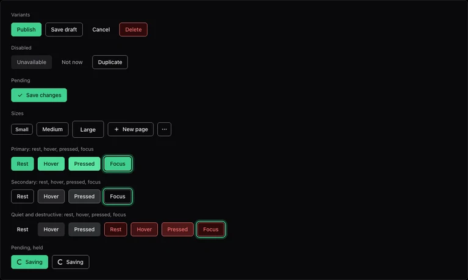

<!-- doc-tier: human | canonical-for: project-overview | budget: 1750tok -->
<picture>
  <source media="(prefers-color-scheme: dark)" srcset="docs/readme/banner-night.svg">
  
</picture>

**An open-source CMS you can run on your own computer or a server.**
Define your own fields, edit content visually, and publish it through an API.
Build a website or keep a recipe collection. Use only what you need.

[What the button does](docs/setup/DEPLOY-WITH-BARKPARK.md), and how to add it to your template.

## What you can do

| Write | Work | Run |
|---|---|---|
| Content: own fields, drafts | Tasks, agent queues, tickets | Websites, deploys, domains |
| Papers that update live | Agents you task and check | Servers: start, restore |
| Sheets: formulas, Excel | Search with facets | Tokens, sharing, sign-on |
| Media: tags, rights | Quizzes, ONIX book data | Revisions to go back to |

In the browser, the terminal, the CLI or through an agent.

## Where we're going

As of 26 November: an alpha in December, and the focus now is good and stable.

<picture>
  <source media="(prefers-color-scheme: dark)" srcset="docs/readme/progress-night.svg">
  
</picture>

| Pillar | Now |
|---|---|
| UI kit: [BarkUI](js/packages/barkui) | Building. 14 parts |
| Next-gen editor: [Fluid editor][fe] | Advanced. 3 of 7 milestones |
| [BarkBot][bb] | Building. 1 of 8 slices |
| Apps in use: [Studio][st], Papers, Sheets | Early. Studio: 51 of 66 journeys signed off |
| Invisible Barkpark: [Barkdown][bd], [Barkever][be] | Partial. Barkever: 3 of 8 milestones |

## The family

- **Barkpark**, here: the core, the API, Papers, Sheets, the CLI, BarkUI.
- **[Studio][st]**: the editing room, fast and calm.
- **[Barkdown][bd]**: a desktop app for notes, agents and browsing.
- **[Barkever][be]**: notes and projects for visual thinkers.
- **[PortableDoc][pd]**: one document format for every app.
- **[Fluid editor][fe]**: a grid editor where you place blocks freely.
- **[BarkBot][bb]**: an AI agent with its own computer.

## Local or remote

On your computer it all stays with you and works offline; on a server, several people share it.
Each holds its own data, and you move it between them on purpose.

## News

<!-- news:start -->
**Thursday 26 November.** 53 pull requests merged. In the Studio, browser Back and a link over a held field now ask with the desk's leave dialog, and while that question is open after a Back into another project, nothing is written, reloaded or opened there. A top-level rich text and the rows of an array are now read under the document's lock and by each row's key, so another editor's save or row move is merged or held under the banner, not written over. Creating a workspace now needs a write seat in a workspace that is not suspended, on REST, in the Studio and in the chrome, and two same-slug papers in two projects no longer make a public papers page answer 500. [The full day](docs/news/2026-11-26.md)
- **Leave question in the Studio:** Back, links and presses over a held field ask with the desk's dialog; under it, after a Back into another project, nothing is written, reloaded or opened there ([#28937](https://github.com/FRIKKern/barkpark/pull/28937), [#28953](https://github.com/FRIKKern/barkpark/pull/28953), [#28968](https://github.com/FRIKKern/barkpark/pull/28968), [#28976](https://github.com/FRIKKern/barkpark/pull/28976))
- **Two editors, one document:** a top-level rich text is read under the lock; array rows go by their key; a rejoined page's hold stays until Save or Reload ([#28933](https://github.com/FRIKKern/barkpark/pull/28933), [#29036](https://github.com/FRIKKern/barkpark/pull/29036), [#29040](https://github.com/FRIKKern/barkpark/pull/29040), [#29043](https://github.com/FRIKKern/barkpark/pull/29043))
- **Who may create a workspace:** a write seat in the workspace it acts from, and never from a suspended one, on REST, in the Studio and in the chrome ([#28980](https://github.com/FRIKKern/barkpark/pull/28980), [#28999](https://github.com/FRIKKern/barkpark/pull/28999), [#29014](https://github.com/FRIKKern/barkpark/pull/29014))

**Wednesday 25 November.** 74 pull requests merged, 49 of them on two people editing one document. Two editors who type in different words of one paragraph of a rich text inside an object now both keep their words, with no banner, and a save that lands while another is being written is merged or held under the banner, never written over in silence: in Chrome that loss fell from 4 of 4 Studio runs to 0 of 10. A chat on a registered host, a person's own computer, can now be created, driven and seen only by an owner or admin seat. A javascript: link inside a rich text stored as HTML is now refused on write, and a bundle import strips such an address from a Portable Text link. [The full day](docs/news/2026-11-25.md)
- **Two editors, one document:** different words of one paragraph merge; a save landing under another is merged or held, never written over, also on a rejoin and on Save ([#28781](https://github.com/FRIKKern/barkpark/pull/28781), [#28802](https://github.com/FRIKKern/barkpark/pull/28802), [#28817](https://github.com/FRIKKern/barkpark/pull/28817), [#28792](https://github.com/FRIKKern/barkpark/pull/28792), [#28803](https://github.com/FRIKKern/barkpark/pull/28803), [#28833](https://github.com/FRIKKern/barkpark/pull/28833), [#28830](https://github.com/FRIKKern/barkpark/pull/28830))
- **Chat on a person's computer:** only an owner or admin seat creates, drives, sees or counts a registered-host chat; an answered question keeps its answers ([#28693](https://github.com/FRIKKern/barkpark/pull/28693), [#28844](https://github.com/FRIKKern/barkpark/pull/28844), [#28848](https://github.com/FRIKKern/barkpark/pull/28848), [#28852](https://github.com/FRIKKern/barkpark/pull/28852))
- **Links and stored HTML:** a script link is refused in an HTML rich text on write and stripped from an imported link; stored ids move out of the page's way; a NUL byte is a 422 ([#28695](https://github.com/FRIKKern/barkpark/pull/28695), [#28728](https://github.com/FRIKKern/barkpark/pull/28728), [#28659](https://github.com/FRIKKern/barkpark/pull/28659), [#28712](https://github.com/FRIKKern/barkpark/pull/28712))
<!-- news:end -->

Earlier: [weekly editions](CHANGELOG.md)

## Get started

[Run locally](docs/setup/QUICKSTART.md) · [Open Studio](https://api.barkpark.cloud/studio) · [Deploy a server](docs/setup/SELF-HOST.md) · [Connect an agent](docs/setup/AGENT-ONRAMPS.md)

[Documentation](docs/INDEX.md) · [JavaScript docs site](js/docs/README.md) · [Build a plugin](docs/cards/plugins.md) · [Principles](docs/PHILOSOPHY.md)

[Apache-2.0 licensed](LICENSE). Optional [Barkpark Cloud](https://barkpark.cloud) hosting funds development.

<picture>
  <source media="(prefers-color-scheme: dark)" srcset="docs/readme/rib-night.svg">
  
</picture>

[st]: https://github.com/FRIKKern/barkpark-studio
[bd]: https://github.com/FRIKKern/barkdown
[be]: https://github.com/FRIKKern/barkever
[pd]: https://github.com/FRIKKern/portable-doc
[fe]: https://github.com/FRIKKern/fluid-editor
[bb]: https://github.com/FRIKKern/barkbot
