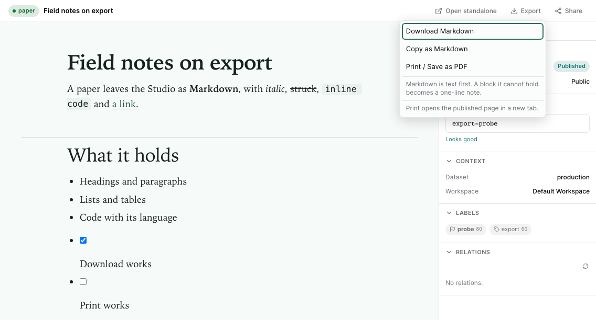
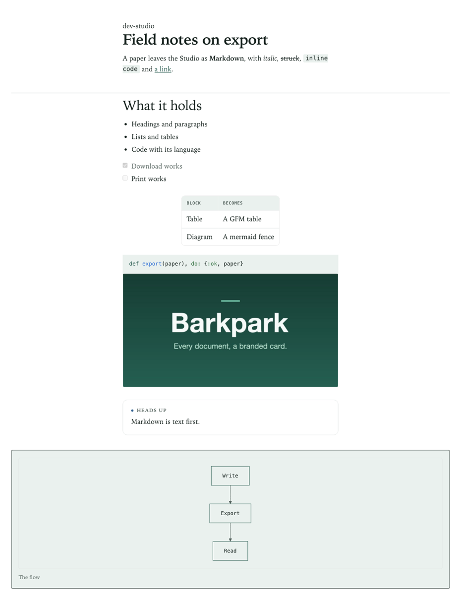

<!-- doc-tier: human | canonical-for: news-2026-11-15-paper-export | budget: 2000tok -->
# Take a paper with you: Markdown, copy, or PDF

*A paper written in Barkpark Studio can now leave it as a Markdown file, as text on your clipboard, or as a printed PDF. A fresh review then went looking for what else rode along.*

The Export menu in a paper's header. A local test run on a probe paper.

## What you can do now

Open a paper in the Studio. Press **Export** in its header. You get three choices:

- **Download Markdown** saves the whole paper as a `.md` file, title first, in the order you wrote it.
- **Copy as Markdown** puts the same text on your clipboard and says "Copied".
- **Print / Save as PDF** opens the paper's published reading page in a new tab and prints it, without the editor around it.

Until now a paper left the Studio only as raw JSON from the command line. Now anyone who can read a paper can take it to an email, a wiki, a Git repo or a printer. It works for viewers who cannot edit, and it includes typing that has not been saved yet.

## How a paper becomes Markdown

A paper is not one long text. It is runs of writing with blocks between them: tables, images, steps, tabs, diagrams. The export walks the paper in order:

| Part of the paper | Becomes |
|---|---|
| Writing | Headings, paragraphs, lists and links, exactly as on screen |
| Table | A GitHub-style table, with column alignment |
| Diagram | A `mermaid` code block |
| Code | A fenced block with its language |
| Steps | A numbered list with each step's content under it |
| Chart and other drawn blocks | One line saying it was left out, plus its words |

Markdown is text first, and the menu says so. Nothing is dropped silently: a block that cannot become Markdown leaves a line saying what was there.

Print uses the published reading page, which has print styles and no editor handles.

## What review found

A fresh review, by a reviewer who had not written the code, passed it and found four smaller things to fix later.

The most interesting one is about what the page carries, not what the file holds. To export blocks that sit between runs of writing, the Export button carries those blocks in the page. For a table you can edit, it carries a clean copy. But for a read-only table, or a table inside steps, tabs or columns, it carried the table's raw stored form, internal keys included. The reviewer proved it with a probe page.

It crossed no permission line: the viewer can already read the paper, and other parts of the page already carry the same kind of keys. So it did not block the merge. It is filed as follow-up work, together with three Markdown edge cases the reviewer confirmed with a second Markdown parser: two lists side by side merge into one, a `|` inside inline code splits a table cell, and a few line-start markers turn text into a list.

## What it unlocks

Papers are where Barkpark writes plans, reports and notes. With export they stop being locked in: a plan can go into a pull request, a report into an email, a note onto paper.

## Proof

- Pull request: [#26513](https://github.com/FRIKKern/barkpark/pull/26513), merged 15 November 2026 as `484ba28f`.
- Review: passed on head `da5a6758`, with 81 checks green. Not run by the reviewer: a browser check; the gettext, golden-pack, conformance and canvas tests were left to CI.
- Code: `api/assets/paper-editor/src/markdown/export.js`, `api/lib/barkpark_web/live/studio/studio_live/components/paper_export.ex`. Tests: `api/test/barkpark_web/paper_export_test.exs`, `api/assets/paper-editor/src/__markdown_export.test.mjs`.
- The two follow-ups (raw table data in the page; the Markdown edge cases) are open.
- Pictures: screenshots from the builder's local run on a probe paper, cropped.
