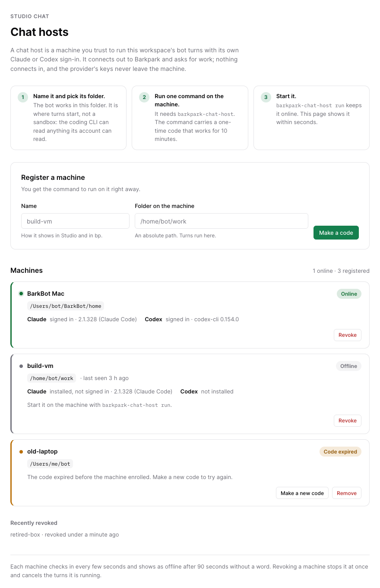

<!-- doc-tier: human | canonical-for: news-2026-11-20 | budget: 3000tok -->
<!-- news-day: {"summary": "49 pull requests merged. The desk, Barkpark's own document editor, gained a Tasks sidebar, a who-is-here menu, language tabs, and Params and pickers in Vision; Mod+Z now undoes slugs, selects, lists and nested fields. A workspace owner can register a chat host over ssh in one step. Codelists and select lists keep what is stored, and Paper source mode never changes a Paper it cannot carry.", "groups": [{"label": "Desk", "text": "a Tasks sidebar; who is here as one menu; language tabs; Params and pickers in Vision; Mod+Z undoes slugs, selects, lists and nested fields", "prs": [27767, 27884, 27533, 27695, 27728, 27680]}, {"label": "Chat hosts and Papers", "text": "add a host over ssh in one step; a new code for a waiting host; a rebuilt Studio page; source mode never changes a Paper it cannot carry", "prs": [27651, 27643, 27665, 27555]}, {"label": "Kept values", "text": "a codelist takes one short code; Paste writes codelists; select lists in objects and rows save as lists; a refused clear stays as stored", "prs": [27955, 27970, 27969, 27958, 27936]}], "projects": {"barkui": {"summary": "BarkUI, meant to give every Barkpark app one look, got its showroom: one page with every part live in five skins, light and dark, and lights a browser check turns on only for what its last run proved. The first part is the button. BarkUI also has its own README, roadmap and decision records.", "groups": [{"label": "Showroom", "text": "every part live in every skin and surface; the check drives it with real keys and a real pointer; the button first", "prs": [27193]}, {"label": "Check", "text": "one CI job per group of up to five parts; up to 40 parts need no new check row; a field's placeholder matches its wait on the sheet", "prs": [27718, 27777, 27914]}, {"label": "Front door", "text": "a README with pictures, a roadmap and eight decision records", "prs": [27779]}]}}} -->
# Barkpark · Friday 20 November 2026

49 pull requests merged. Thirty went to the desk, Barkpark's own document editor, being rebuilt to match the TanStack Studio (the separate Studio app); four of those also fixed the old Studio. Five went to Papers, four to chat hosts (the machines that run a workspace's chat turns), five to BarkUI, and one each to schema rules, task fields, Barkpark Cloud and the server's local-only routes. One was Thursday's News page.

## What a person can now do

**Vision picks a dataset, an API version and Params** ([#27695](https://github.com/FRIKKern/barkpark/pull/27695), [#27728](https://github.com/FRIKKern/barkpark/pull/27728), [#27730](https://github.com/FRIKKern/barkpark/pull/27730)). In the desk's query tool:

1. Pick a **Dataset**: the page's project's datasets, with the page's own picked.
2. Pick an **API version**: Sanity's list, then today's date (the default), then Other for your own.
3. Under the query, type **Params**, a JSON object the query reads as `$key`. Params that are not an object send nothing, and the result says why.

The dataset, version and Params are kept in this browser with the query.

**A Tasks sidebar** ([#27767](https://github.com/FRIKKern/barkpark/pull/27767)). While the workspace's Tasks plugin is on, a **Tasks** button sits in the navbar and at the foot of the phone drawer. It lists the project's tasks under **All** (To Do, and Done folded) or **Active Document** (tasks linked to the open document). A task opens read-only. Each workspace's own task schema decides which task fields its own board, list and desk sidebar show ([#27943](https://github.com/FRIKKern/barkpark/pull/27943)).

**Who is here** ([#27884](https://github.com/FRIKKern/barkpark/pull/27884), [#27966](https://github.com/FRIKKern/barkpark/pull/27966), [#27980](https://github.com/FRIKKern/barkpark/pull/27980)). Other people online are one 44 px button with a dot, not a row of avatars. Its menu lists each person and their document; a row opens that document. Under 600 px your own presence pill gives way, and **Your profile** (the name and colour others see) is in the phone drawer. Every navbar menu works by keyboard: arrows, Home, End, Tab and Escape.

**Language tabs** ([#27533](https://github.com/FRIKKern/barkpark/pull/27533)). A `localizedText` field is a row of tabs, one per language, open on its primary language. A dot marks a language with text, a red mark one with an error. With the primary empty, a line says which language readers get instead. Emptying a language removes it from the stored value.

**Undo covers more** ([#27680](https://github.com/FRIKKern/barkpark/pull/27680)). Mod+Z takes back your change of a slug, a select, a list (items added, removed, moved or typed in) and an object's nested fields. Other editors' changes stay; a select or other single value they changed since is not undone. Later the same day:
- an undo writes only while the field still holds the value it read, and its step starts from the value your save wrote over ([#27770](https://github.com/FRIKKern/barkpark/pull/27770), [#27857](https://github.com/FRIKKern/barkpark/pull/27857));
- a focus you move while an undo is on its way stays put, focus mode included, and an open desk menu closes ([#27820](https://github.com/FRIKKern/barkpark/pull/27820), [#27786](https://github.com/FRIKKern/barkpark/pull/27786));
- with a modal open, Mod+Z changes no field behind it ([#27824](https://github.com/FRIKKern/barkpark/pull/27824)); a focused select takes another editor's later save ([#27861](https://github.com/FRIKKern/barkpark/pull/27861)).

**Read-only views** ([#27703](https://github.com/FRIKKern/barkpark/pull/27703), [#27801](https://github.com/FRIKKern/barkpark/pull/27801), [#27908](https://github.com/FRIKKern/barkpark/pull/27908)). In the published view and on an old revision the group tabs switch, the fields stay read-only, and a read-only text field shows the stored value even if it had the focus. With History open, All fields stays live. Reload in the conflict banner is disabled where the view refuses it, and nothing written in the published view can change the draft ([#27888](https://github.com/FRIKKern/barkpark/pull/27888)).

**Kept as stored**, in the desk; the first four in the old Studio too.
- A tree codelist over a stored value that is no code offers **Remove**, top-level and in an object ([#27740](https://github.com/FRIKKern/barkpark/pull/27740)).
- A checkbox list of select values keeps its stored order and types when another field is edited ([#27958](https://github.com/FRIKKern/barkpark/pull/27958)).
- Ticks of a select list in an object or a list row save as a list. A document holding a single string there opens and keeps it until that list is edited ([#27969](https://github.com/FRIKKern/barkpark/pull/27969)).
- What you type into a codelist field saves only as one code of up to 64 characters, or a clear. Anything else writes nothing for that field, which reads "Not saved"; the rest of the post saves ([#27955](https://github.com/FRIKKern/barkpark/pull/27955)).
- **Paste field** and **Paste document** write a codelist value or a list of them. A code its list lacks is stored with a Validation warning; anything else is refused in words ([#27970](https://github.com/FRIKKern/barkpark/pull/27970), [#27986](https://github.com/FRIKKern/barkpark/pull/27986)).
- A clear the store refuses stays as stored and reads "Not saved"; later saves leave it out until you change that field ([#27936](https://github.com/FRIKKern/barkpark/pull/27936)).

**Chat hosts.** The workspace owner can:

1. Run `bp chat-host add --ssh user@host --name <name> --root <path>`. bp makes the one-time code with the owner's token and runs the machine's enroll over ssh, the code on stdin. If ssh fails, bp says what to do next ([#27651](https://github.com/FRIKKern/barkpark/pull/27651), [#27707](https://github.com/FRIKKern/barkpark/pull/27707)).
2. Or open Studio > Chat hosts. **Make a code** shows the exact command with a **Copy** button. After a reload the code is not shown again; the card offers **Make a new code** ([#27665](https://github.com/FRIKKern/barkpark/pull/27665)).
3. Make a new code for a waiting host. The old one stops working at once: "A newer code replaced this one" ([#27643](https://github.com/FRIKKern/barkpark/pull/27643)).

Each machine is a card with its state in words. Revoke asks first. A workspace admin gets no register form and is told to ask the owner.

**Papers.**
- Markdown source mode opens a Paper for typing only when a save keeps everything stored. Otherwise it opens read-only and names the block: "Read only: Markdown cannot carry the start of block 2, a list, yet." A save it cannot carry is refused with one line, your text kept ([#27555](https://github.com/FRIKKern/barkpark/pull/27555)). The check now runs on every shared Portable Doc fixture ([#27863](https://github.com/FRIKKern/barkpark/pull/27863)).
- Markdown export keeps every word of a callout's body ([#27865](https://github.com/FRIKKern/barkpark/pull/27865)).
- `bp paper pull` prints what a reader sees. An unedited push writes nothing; a push that writes answers the Paper as saved, which is the next pull. Update bp (`make update`) for its half ([#27601](https://github.com/FRIKKern/barkpark/pull/27601)).

**Schema rules** ([#27890](https://github.com/FRIKKern/barkpark/pull/27890)). Cross rules (checks across fields) compare two fields with `gt`, `gte`, `lt`, `lte` and `valueField`, and `one` asks for exactly one of several. So an event's end can be held to not before its start; a missing end never breaks it.

**Cloud.** `bp cloud status` says whether a provisioning or failed launch got a warm server (one kept booted and ready), and why not ([#27659](https://github.com/FRIKKern/barkpark/pull/27659)).

## BarkUI

Told in [its own README](../../js/packages/barkui/README.md): the showroom, every part live with lights a browser check turns on only for what it proved, starting with the button ([#27193](https://github.com/FRIKKern/barkpark/pull/27193)); the check as one CI job per group of parts ([#27718](https://github.com/FRIKKern/barkpark/pull/27718)); a README, roadmap and decision records ([#27779](https://github.com/FRIKKern/barkpark/pull/27779)).

## Where it is slow or rough

- Of 140 seed and fixture Papers, 117 open read-only in source mode, all for text marks Markdown cannot carry yet: 98 in a paragraph, 12 in a list, 7 in a callout ([#27555](https://github.com/FRIKKern/barkpark/pull/27555)).
- Vision has no highlighting query editor, Listen or saved queries yet ([#27695](https://github.com/FRIKKern/barkpark/pull/27695)). The Tasks sidebar cannot create or edit and does not refresh live ([#27767](https://github.com/FRIKKern/barkpark/pull/27767)).
- Autosave does not yet check a list of codelists or a codelist in an object ([#27955](https://github.com/FRIKKern/barkpark/pull/27955)).
- A Paper in a dataset with no paper schema cannot be saved through BPML; the seeded schemas cover `production` only ([#27601](https://github.com/FRIKKern/barkpark/pull/27601)).
- `add --ssh` was tested with ssh stubbed, not yet on a real machine ([#27651](https://github.com/FRIKKern/barkpark/pull/27651)).

## Across the projects

The desk passed two more of the Studio's recorded checks (language tabs; undo of a select and a list item) and got further in two (Vision, the navbar). Studio answers the new rules as Barkpark does ([FRIKKern/barkpark-studio#1338](https://github.com/FRIKKern/barkpark-studio/pull/1338)) and shows cross-field rules as you type ([#1336](https://github.com/FRIKKern/barkpark-studio/pull/1336)). BarkBot's host scripts hand the enrollment code over on stdin, as `add --ssh` does ([FRIKKern/barkbot#289](https://github.com/FRIKKern/barkbot/pull/289)).
