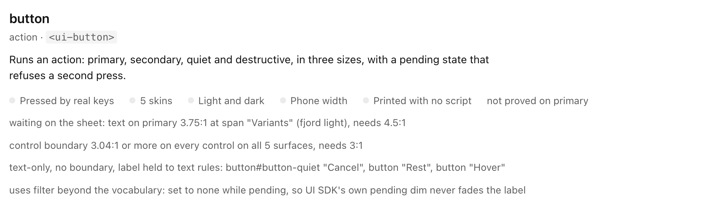

<!-- doc-tier: human | canonical-for: barkui-quality | budget: 1600tok -->
# Quality

The showroom is the scoreboard ([0004](docs/decisions/0004-ready-before-any-switch.md)). Each part shows its lights, written by `pnpm run check`, which presses every part in headless Chromium. The full rules are in [docs/PARTS.md](docs/PARTS.md); this page says what they add up to.

## The lights

| Light | On means |
|---|---|
| Pressed by real keys | Every step in the part's `press.mjs` ran with real key presses or clicks and got the result it expects; where the part lists them, a screen reader gets the role, name and states it promises |
| Every skin | Every colour on every element in the part is one of the sheet's variables and changes with the skin; every visible thing draws in full; text reads at 4.5:1 and graphics at 3:1; every control's edge or fill stands at 3:1 off its ground; the focus ring's edge reads at 3:1 on every Tab stop |
| Light and dark | Dark paints values of its own in every skin, and the same rules hold there |
| Phone width | The part is read in full in a 390px window, in every skin and scheme |
| Printed with no script | With scripts off, everything in the part that carries text or an icon is printed, seen and painted from the sheet, with text at 4.5:1 |

A light is on only when the last run passed and proved it for the same part folder, tokens, base styles, UI SDK version and check code. Change any of them and every light it rests on goes off until the check runs again. A run that fails in any way, through a step, a page error, a network request or a time limit, turns off every light of that part and says why.

Lights are proved on the base surface. On any other surface they show grey, "not proved on" that surface, never on. The check still measures text and control edges on the other surfaces. Where the sheet falls short, the showroom prints a "waiting on the sheet" line instead of turning a light off, until that measure is made hard in `build/sheet-waits.mjs`.

## When a part counts as ready

- Its folder is whole: `part.json`, `part.css`, `example.html` and `press.mjs`. Adding it changed nothing outside the folder.
- `part.css` reads only the sheet's colours, stays inside the property vocabulary, and draws no focus ring of its own.
- Every light is on from a run of the check on that folder, as it is on main.
- For the first six parts, also the step in [0004](docs/decisions/0004-ready-before-any-switch.md).

A "waiting on the sheet" line is a gap in the sheet, not in the part. It is work for M2 ([ROADMAP](docs/ROADMAP.md)).

## The check guards itself

`pnpm run check:selftest` plants one break per case in a scratch copy of a part, such as a colour from outside the sheet, a cut label or a demo that styles the page, and fails unless the check fails for the right reason. When CI runs it is in [docs/PARTS.md](docs/PARTS.md).

## Docs

- Picture first: the README, the roadmap and the decisions open with a picture, a diagram or a table.
- One fact, one home ([README](README.md#where-things-live-one-fact-one-home)). Which parts exist, and what is proven for each, lives on the showroom page only, so adding a part changes no other file.
- No number on these pages is typed by hand. Two scripts write the blocks that hold numbers, each with the day its numbers last changed and a stamp: `node build/status.mjs` (skins, surfaces, colour names and the UI SDK pin, from the sheet and package.json) and `node build/board.mjs <goal-task-id>` (each milestone's progress, from the task board; it needs `bp`). The daily news run calls both and its PR carries what they wrote; either can also be run by hand. No PR check reads the board. A fast test fails when a block is edited without its script or changes shape, never because the files or the board moved.
- Pictures are real showroom shots, never mock-ups. `node build/pictures.mjs` retakes every picture these pages show, after `pnpm run build` and `pnpm run check`.
