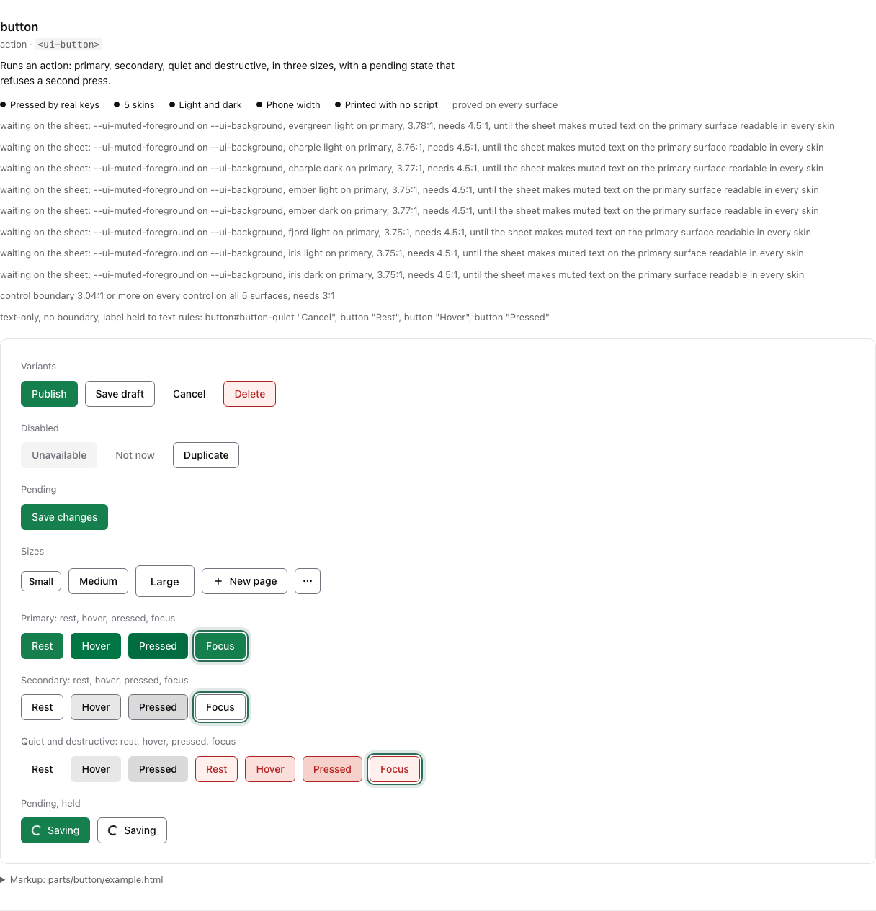
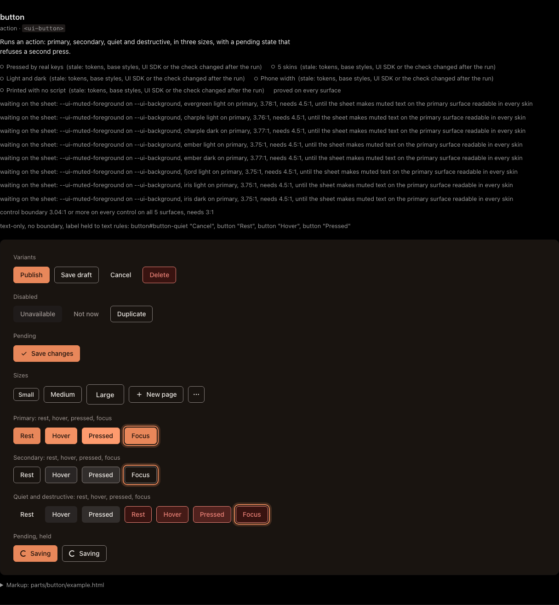
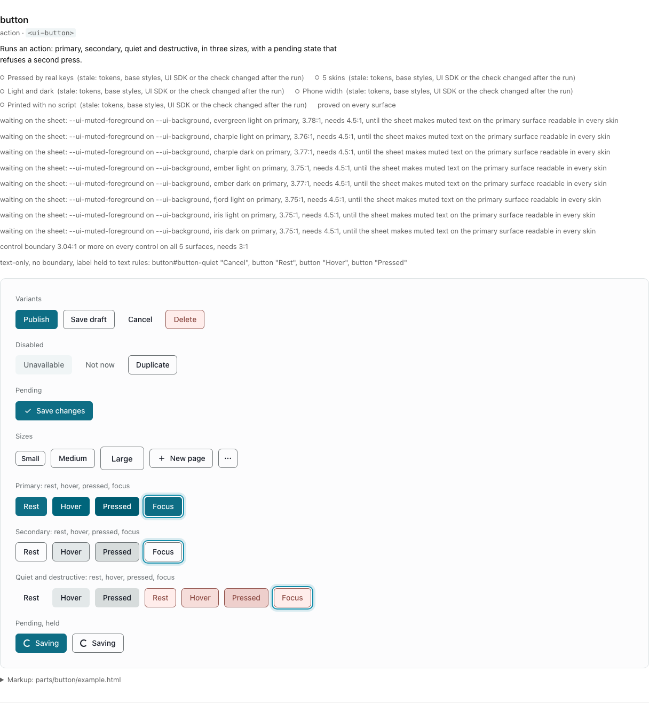

<!-- doc-tier: human | canonical-for: barkui-home | budget: 5000tok -->
# BarkUI

<picture>
  <source media="(prefers-color-scheme: dark)" srcset="docs/images/showroom-dark.png">
  
</picture>

**One look for every Barkpark app.** BarkUI is meant to draw the parts our apps are made of, from buttons to page trees, and every block of a PortableDoc document, in one set of skins. What stands today: the sheet of skins, the parts the showroom lists, and the showroom check that proves each one. What is not built yet reads as planned, with no dates. It lives in Barkpark for now as the private package `@barkpark/barkui`.

## Vision

Barkpark Studio, Barkdown, Barkever, BarkBot and the Barkpark desk each draw their own controls and name their own colours today. BarkUI is to give them one set, and an app will pick a skin. Each skin file names a ground, an ink and an accent colour for light and for dark; the deriver works out the rest, and where a worked-out colour has to stay as it was, the skin pins it in `overrides` with a reason for each pin.

UI SDK supplies the behaviour: focus, menus, trees, grids, drag. BarkUI supplies the look and follows UI SDK's own way of naming parts, states and colours ([0001](docs/decisions/0001-ui-sdk-names-are-the-contract.md)). The plan: PortableDoc keeps what a document is and BarkUI draws it ([0002](docs/decisions/0002-barkui-draws-portable-doc-defines.md)); a table in a document and a table in an app become one part ([0003](docs/decisions/0003-a-block-is-a-part.md)).

No app moves before the step written in [0004](docs/decisions/0004-ready-before-any-switch.md). Then apps will move a screen at a time, and a new look will be a change of skin.

## What we get

| Reward | Milestone |
|---|---|
| One colour source writes every skin under UI SDK's names | M2 |
| One page shows every part in every skin, light and dark, and what is proven for it | Ready |
| The editor's menus and Barkdown's page tree run on BarkUI parts | M3 |
| A table in a document and a table in an app are one part | M4 |
| Studio, Barkdown, Barkever, BarkBot and the Barkpark desk wear one look | M5 |
| New app designs that separate kits could not carry | M6 |

## News

The daily news run fills this block from merged work that touches BarkUI. Nothing here is written by hand.

<!-- news:start -->
**Monday 23 November.** The BarkUI check now reads a part's look only on a page at rest: every read, every change the checker makes and every act are settled first, inside 2 s, and a read on a moving page is red by name. The page's scroll is put back after each capture, and a shot taken while the page moved with a box fixed to the view in it is taken again. [The full day](../../../docs/news/2026-11-23.md)
- **Check:** a look is read only on a page at rest; the scroll is put back after each capture; a moved shot with a fixed box is taken again ([#28389](https://github.com/FRIKKern/barkpark/pull/28389), [#28515](https://github.com/FRIKKern/barkpark/pull/28515), [#28527](https://github.com/FRIKKern/barkpark/pull/28527))

**Sunday 22 November.** The BarkUI check now reads a part's popovers and modal dialogs open, against what the page draws behind them, and refuses by name any box that can open there without being named. A part lists what it does not cover in one place, printed under it in the showroom. Every selftest case runs under one 60 s limit. [The full day](../../../docs/news/2026-11-22.md)
- **Check:** popovers and dialogs read open; a style attribute may hold placement only; the part's context holds the check's own two pages and no other ([#28122](https://github.com/FRIKKern/barkpark/pull/28122), [#28239](https://github.com/FRIKKern/barkpark/pull/28239), [#28336](https://github.com/FRIKKern/barkpark/pull/28336))
- **Parts:** what a part does not cover is one list in part.json, matched as whole words ([#28249](https://github.com/FRIKKern/barkpark/pull/28249), [#28268](https://github.com/FRIKKern/barkpark/pull/28268))
- **Selftest:** one limit of 60 s per case, each hosted reading under 48 s; the two slow cases split into runs ([#28277](https://github.com/FRIKKern/barkpark/pull/28277))
<!-- news:end -->

## Where things stand

The showroom is the one home for which parts exist and what is proven for each: `pnpm run build`, then open `dist/showroom/index.html`. How far each milestone has come is on the [roadmap](docs/ROADMAP.md#where-things-stand). The block below is written by `node build/status.mjs`; [QUALITY.md](QUALITY.md#docs) says when it runs and what guards it.

<!-- status:start -->
| What | Read from the files |
|---|---|
| Skins in the sheet | 5: evergreen, charple, ember, fjord, iris |
| Surfaces a part can sit on | 5: base, raised, sunken, primary, inverse |
| Colour names in the sheet | 15 `--ui-*` (UI SDK's), 262 `--bark-*` (BarkUI's own) |
| UI SDK | `@ui-sdk/core` and `@ui-sdk/web` 0.1.0-beta.10, pinned to that exact version |

Read from the sheet and package.json; last changed on 2026-11-19.
<!-- stamp: d530f31c45bd0f58 -->
<!-- status:end -->

| ember, dark | fjord, light |
|---|---|
|  |  |

## Where things live (one fact, one home)

| What | Where |
|---|---|
| Why, the plan, the order of work, the contests and trials | Barkpark Paper `/papers/barkui-plan` |
| Milestones, and how far each has come | [`docs/ROADMAP.md`](docs/ROADMAP.md) |
| Decisions | [`docs/decisions/`](docs/decisions/), one page each |
| What the lights mean; when a part counts as ready | [`QUALITY.md`](QUALITY.md) |
| What a part folder holds and what the check does with it | [`docs/PARTS.md`](docs/PARTS.md) |
| Which parts exist and what is proven for each | The showroom, built from [`parts/`](parts/) |
| The colour source: each skin's colours and pins | [`design/themes/`](../../../design/themes/), derived by [`design/derive.mjs`](../../../design/derive.mjs) |
| The name table: today's colour slots to `--ui-*` and `--bark-*` | [`design/emit/barkui.mjs`](../../../design/emit/barkui.mjs), with its surfaces and states beside it |
| The sheet (generated; never edited) | [`api/priv/barkui/tokens.css`](../../../api/priv/barkui/tokens.css) |
| Base styles and the one focus ring | [`css/base.css`](css/base.css) |
| The checks | [`check/`](check/) in a browser, [`tests/`](tests/) without one; in CI the fast tests by `.github/workflows/js-tests.yml`, the browser check by `.github/workflows/barkui.yml`, one job per group of parts |
| The blocks on these pages | [`build/status.mjs`](build/status.mjs) from the files; [`build/board.mjs`](build/board.mjs) from the task board |
| The pictures on these pages | [`build/pictures.mjs`](build/pictures.mjs) |
| Status, who does what | The BarkUI goal on Barkpark's task board |

## Layout

```
build/       the showroom page, part discovery, the page blocks, the pictures
check/       the browser check, its selftest, the surfaces shot
css/         base styles: the page ground, type and the one focus ring
parts/       one folder per part; the build, the check and the tests find parts here
tests/       the fast tests
docs/        roadmap, the part folder and the check, decisions, pictures
```

Outside this folder: the colour source in `design/` and the sheet it writes, `api/priv/barkui/tokens.css`.

## Run it

Node 22 and pnpm, from the repo root.

```sh
cd js && pnpm install && cd packages/barkui
pnpm run build             # dist/showroom/index.html; opens from disk, no server
pnpm run check             # press every part in headless Chromium and light the page
pnpm test                  # the fast tests
node build/pictures.mjs    # retake every picture these pages show (after build and check)
node build/status.mjs      # refresh the block above from the sheet and package.json
node build/board.mjs <goal-task-id>   # refresh the roadmap's block from the board (needs bp)
node ../../../design/emit.mjs --write   # rewrite the sheet after a skin changes
```

Up to 40 parts, a new part is its folder and a changeset. What a part folder needs, what each light reads and how the check runs in CI: [docs/PARTS.md](docs/PARTS.md).

## When BarkUI leaves home

BarkUI grows up inside Barkpark for now. What holds it here, what would make it leave and what would move are in [0007](docs/decisions/0007-incubated-in-barkpark.md).
